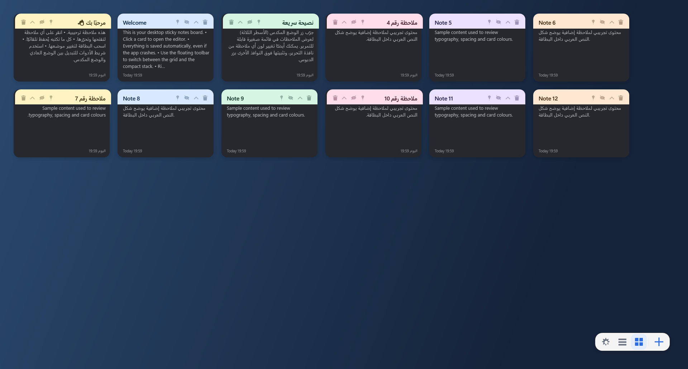
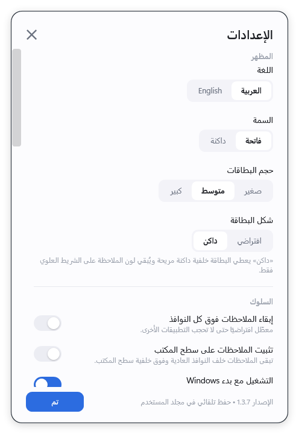
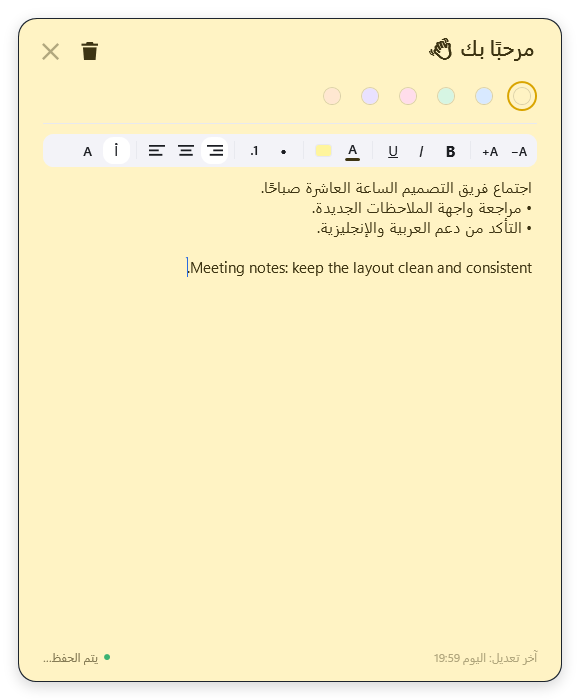

# StickyNotes

<h2 align="center">ملاحظاتك على سطح المكتب، بطريقة بسيطة ومنظمة.</h2>

  <strong>
    StickyNotes هو تطبيق ملاحظات لسطح مكتب Windows، يتيح لك إنشاء بطاقات ملاحظات مستقلة ووضعها على سطح المكتب للوصول السريع إلى أفكارك ومعلوماتك ومهامك اليومية.
  </strong>

## 📸 لقطات من البرنامج

  
   
  <strong>الواجهة الرئيسية</strong>

<table>
  <tr>
    <td align="center" width="50%">
      
       <strong>الإعدادات</strong>
    </td>
    <td align="center" width="50%">
      
       <strong>تخصيص الملاحظات</strong>
    </td>
  </tr>
</table>

صُمم التطبيق ليكون بسيطًا وعمليًا، مع إمكانية تخصيص مظهر بطاقات الملاحظات وحجم النص، ودعم اللغتين العربية والإنجليزية.

---

## 📥 تحميل البرنامج

  

   

  

**اضغط على زر التحميل أعلاه للانتقال إلى صفحة تنزيل أحدث إصدار من البرنامج.**

يتوفر StickyNotes بنسختين:

- **Installer:** تثبيت البرنامج على Windows بالطريقة المعتادة.
- **Portable:** تشغيل البرنامج مباشرة دون الحاجة إلى تثبيت تقليدي.

[**➡️ الانتقال إلى صفحة تحميل البرنامج**](https://github.com/sami-twj/StickyNotes-Releases/releases/latest)

---

## ✨ المميزات

- **ملاحظات سطح المكتب:** إنشاء بطاقات ملاحظات مستقلة تظهر مباشرة على سطح المكتب.
- **تخصيص المظهر:** التحكم في مظهر بطاقات الملاحظات.
- **التحكم بحجم الخط:** تغيير حجم نص جميع بطاقات الملاحظات من إعداد واحد.
- **دعم العربية والإنجليزية:** واجهة متعددة اللغات مع دعم اتجاه الكتابة المناسب لكل لغة.
- **التحديثات:** التحقق من توفر إصدارات جديدة وتنزيل التحديثات.
- **إدارة التحديثات:** إمكانية تنزيل التحديث أو تأجيله أو تخطي إصدار معين.
- **سهولة الاستخدام:** واجهة واضحة وإعدادات منظمة.

## 🚀 طريقة الاستخدام

<h3>1. اضغط على زر التحميل أعلاه.</h3>

<h3>2. اختر النسخة المناسبة لك من صفحة Releases.</h3>

<h3>نسخة التثبيت (المثبتة على الجهاز)</h3>

<h3>تثبّت التطبيق على جهازك مثل أي برنامج عادي. مناسبة إذا كنت تريد استخدام StickyNotes بشكل دائم، مع إمكانية تشغيله من قائمة ابدأ أو اختصار سطح المكتب.</h3>

<h3>اسم الملف: <code dir="ltr">StickyNotes-Setup.exe</code></h3>

<h3>النسخة المحمولة (بدون تثبيت)</h3>

<h3>لا تحتاج إلى تثبيت؛ فقط شغّل الملف التنفيذي مباشرة. مناسبة إذا كنت تفضّل تشغيل التطبيق دون تثبيت أو الاحتفاظ بملفه في مجلد تختاره.</h3>

<h3>اسم الملف: <code dir="ltr">StickyNotes-Portable.exe</code></h3>

<h3>3. إذا اخترت نسخة التثبيت، شغّل ملف التثبيت واتبع التعليمات.</h3>

<h3>4. إذا اخترت النسخة المحمولة، شغّل الملف التنفيذي مباشرة.</h3>

<h3>5. افتح StickyNotes وابدأ بإنشاء بطاقات الملاحظات.</h3>

<h3>6. خصّص مظهر البطاقات وحجم النص من الإعدادات.</h3>

<h3>ملاحظة: ملاحظاتك وإعداداتك تُحفظ في مجلد بيانات المستخدم على الجهاز، وليس بجانب ملف النسخة المحمولة.</h3>

## ⚙️ الإعدادات والتخصيص

يوفر التطبيق إعدادات تساعدك على ضبط تجربة الاستخدام، ومنها:

- تغيير لغة الواجهة بين العربية والإنجليزية.
- تخصيص مظهر بطاقات الملاحظات.
- ضبط حجم نص جميع البطاقات من 80% إلى 140%.
- إدارة إعدادات التحديثات.

## 🔄 التحديثات

يستطيع التطبيق التحقق من وجود إصدارات جديدة. عند توفر تحديث، يمكنك اختيار تنزيله أو تأجيله أو تخطي الإصدار.

تظهر معلومات الإصدار وملاحظات التحديث داخل نافذة التحديث.

## 🔒 الخصوصية

تم تصميم StickyNotes كتطبيق سطح مكتب، وتُحفظ بيانات التطبيق محليًا على جهازك.

لا يوفر المشروع مزامنة سحابية أو تخزينًا عبر الإنترنت.

## 📋 معلومات البرنامج

- **النظام:** Windows
- **المعمارية:** x64
- **اللغات:** العربية والإنجليزية
- **صيغ التوزيع:** Installer وPortable

---

# StickyNotes (English)

<h2 align="center">Your desktop notes, simple and organized.</h2>

  <strong>
    StickyNotes is a Windows desktop note-taking application that lets you create independent note cards directly on your desktop, giving you quick access to your ideas, information, and everyday tasks.
  </strong>

It is designed to be simple and practical, with customizable note card appearance, adjustable text size, and support for both Arabic and English.

---

## 📥 Download StickyNotes

  
   
  

Visit the download page to get the latest version of StickyNotes and choose the edition that suits your needs:

- **Installer:** Install the application on Windows using the standard installation process.
- **Portable:** Run the application directly without a traditional installation.

[**➡️ Go to the Download Page**](https://github.com/sami-twj/StickyNotes-Releases/releases/latest)

---

## ✨ Features

- **Desktop Notes:** Create independent note cards displayed directly on your desktop.
- **Appearance Customization:** Customize the appearance of your note cards.
- **Global Font Size:** Adjust the text size across all note cards from one setting.
- **Arabic and English Support:** A multilingual interface with appropriate text direction for each language.
- **Updates:** Check for new releases and download updates.
- **Update Controls:** Download an update, postpone it, or skip a specific version.
- **Simple Interface:** A clear interface with organized settings.

## 🚀 How to Use

<h3>1. Click the download button above.</h3>

<h3>2. Choose the version that suits your needs from the Releases page.</h3>

<h3>Installer (Installed Version)</h3>

<h3>Installs the application on your computer like a regular Windows program. Recommended if you plan to use StickyNotes regularly, with access through the Start menu or a desktop shortcut.</h3>

<h3>File name: <code dir="ltr">StickyNotes-Setup.exe</code></h3>

<h3>Portable (No Installation Required)</h3>

<h3>Does not require installation. Simply run the executable file. Ideal if you prefer not to install the application or want to keep its file in a folder of your choice.</h3>

<h3>File name: <code dir="ltr">StickyNotes-Portable.exe</code></h3>

<h3>3. If you chose Installer, run the setup file and follow the instructions.</h3>

<h3>4. If you chose Portable, run the executable file directly.</h3>

<h3>5. Open StickyNotes and start creating note cards.</h3>

<h3>6. Customize the cards' appearance and text size from Settings.</h3>

<h3>Note: Your notes and settings are stored in your Windows user data folder, not alongside the Portable executable file.</h3>

## ⚙️ Settings and Customization

StickyNotes provides settings to customize your experience, including:

- Switch the interface language between Arabic and English.
- Customize note card appearance.
- Adjust the text size across all cards from 80% to 140%.
- Manage update settings.

## 🔄 Updates

The application can check for new releases. When an update is available, you can download it, postpone it, or skip that version.

Release information and update notes are displayed in the update window.

## 🔒 Privacy

StickyNotes is designed as a desktop application, and its application data is stored locally on your device.

The project does not provide cloud synchronization or online storage.

## 📋 Application Information

- **Platform:** Windows
- **Architecture:** x64
- **Languages:** Arabic and English
- **Distribution:** Installer and Portable
